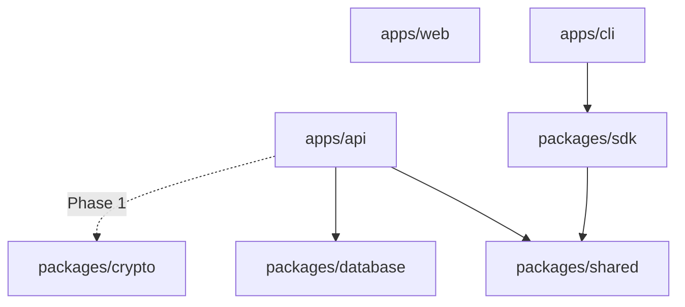
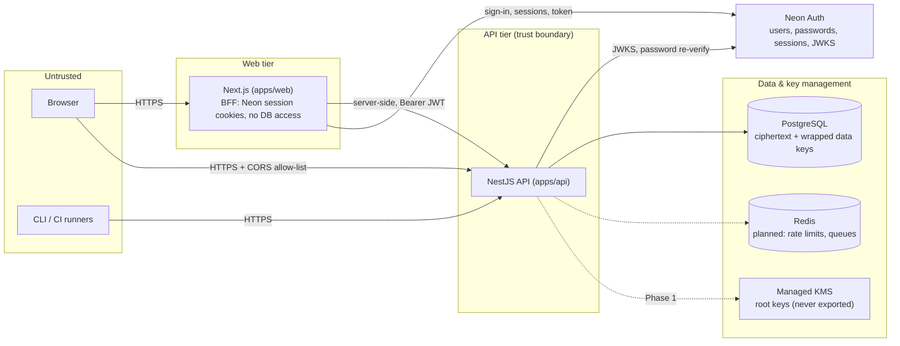

# EnvVault Architecture

> Status: **Phase 3A — Self-managed encryption and key management** (on top of Phase 2 projects, environments and hierarchical authorization). This document describes the architecture as
> implemented today and the boundaries that later phases build on. Sections marked
> _Planned_ describe intended designs that are not implemented yet.

## 1. Goals and constraints

EnvVault is a multi-tenant platform for managing environment variables and secrets
across workspaces, projects and custom environments. The architecture is shaped by
three non-negotiable constraints:

1. **Secrets are never stored or logged in plaintext.** Values are envelope-encrypted
   before persistence; encryption root keys never leave a managed KMS.
2. **The API is the only trust authority.** The browser, the CLI and CI runners are
   untrusted clients; every authorization decision happens server-side.
3. **Proven building blocks only.** No home-grown authentication protocols or
   cryptographic primitives.

Phase 0.1 deliberately ships a **modular monolith** (one API process, one web app).
Module boundaries inside the API are drawn so that extraction into separate services
stays possible, but there is no microservice split at this stage.

## 2. Repository layout

| Path                        | Package              | Responsibility                                                                              |
| --------------------------- | -------------------- | ------------------------------------------------------------------------------------------- |
| `apps/web`                  | `@envvault/web`      | Next.js App Router frontend (Server Components by default, Tailwind CSS, shadcn/ui)         |
| `apps/api`                  | `@envvault/api`      | NestJS REST API, the system's trust boundary                                                |
| `apps/cli`                  | `@envvault/cli`      | `envvault` command-line client (currently `health`; secret commands come later)             |
| `packages/shared`           | `@envvault/shared`   | Framework-agnostic contracts: Zod schemas, API constants, request-ID rules                  |
| `packages/sdk`              | `@envvault/sdk`      | Typed REST client used by the CLI and, later, external consumers                            |
| `packages/database`         | `@envvault/database` | Prisma schema, migrations and client factory (**server-only**)                              |
| `packages/crypto`           | `@envvault/crypto`   | Envelope-encryption boundary: KMS provider interface + AES-256-GCM cipher (**server-only**) |
| `packages/config`           | `@envvault/config`   | Shared TypeScript, ESLint and Prettier configuration                                        |
| `infrastructure/docker`     | —                    | Docker Compose for local PostgreSQL and Redis                                               |
| `infrastructure/deployment` | —                    | Deployment manifests (_planned_)                                                            |
| `docs`                      | —                    | Architecture and project documentation                                                      |

### Package dependency rules



- `shared` has no dependencies other than Zod and must stay runtime-agnostic (browser, Node, edge).
- `database` and `crypto` are **server-only**. They must never be imported by `apps/web`
  or `packages/sdk`, because that would pull server code (and potentially key-handling
  logic) towards untrusted runtimes.
- Apps never import from each other. Shared behaviour moves into a package.
- `config` is a dev-time dependency only.

All packages are native ESM (`"type": "module"`), compiled with `tsc` to `dist/`, and
consumed through `workspace:*` dependencies and their `exports` maps. Turborepo builds
dependencies first (`dependsOn: ["^build"]`).

## 3. Trust boundaries



- The **web app has no database access**. Its only server secret is
  `NEON_AUTH_COOKIE_SECRET` (validated lazily by `src/server-env.ts`). Public
  configuration (`NEXT_PUBLIC_*`) is validated at build/start time by `src/env.ts`.
- **Neon Auth** owns credentials. The API trusts only tokens it verifies against Neon's
  JWKS; it never trusts user or workspace IDs supplied by the client.
- The **API** is the only component that talks to PostgreSQL, Redis and (later) the KMS.
- **PostgreSQL** will only hold ciphertext and KMS-wrapped data keys, never plaintext
  secret values and never root keys.

## 4. API (apps/api)

### 4.1 Module structure

```
src/
  main.ts                 bootstrap: load + validate env, create app, listen
  app.module.ts           AppModule.register(env) — composes feature modules
  app.setup.ts            HTTP config shared by main.ts and e2e tests
  config/                 Zod env schema, .env loading, APP_ENV provider
  common/
    filters/              AllExceptionsFilter (uniform error envelope)
    pipes/                ZodValidationPipe (input validation)
    logging/              pino-http configuration, request-ID resolution
  database/               DatabaseService (Prisma client lifecycle)
  health/                 GET /api/v1/health, GET /api/v1/health/ready
```

New domains (workspaces, projects, environments, secrets) are added as feature modules
next to `health/`, each owning its controller, service and DTO schemas.

### 4.2 Request pipeline

Every request passes through the same stack, in order:

1. **Helmet** sets security headers (CSP, HSTS, `nosniff`, frame protection) and
   removes `X-Powered-By`.
2. **CORS** uses an exact-match origin allow-list from `CORS_ORIGINS`. Wildcards are
   rejected by env validation; production requires `https` origins.
3. **JSON body parser** has a 100 kB limit. Malformed or oversized bodies return
   400 or 413 envelopes.
4. **pino-http** resolves the request ID and logs request completion.
5. **ThrottlerGuard** applies global rate limiting (`RATE_LIMIT_MAX` per
   `RATE_LIMIT_TTL_SECONDS`, per client IP).
6. **Versioned routing**: the global prefix `api` plus URI versioning gives `/api/v1/...`.
   Unversioned paths return 404.
7. **Pipes**: `ZodValidationPipe(schema)` validates body, query and params, using
   schemas from `@envvault/shared` where they are part of the public contract.
8. **AllExceptionsFilter** turns every error into the uniform envelope.

### 4.3 Error contract

All non-2xx responses share one shape (`apiErrorResponseSchema` in `@envvault/shared`):

```json
{
  "error": {
    "statusCode": 404,
    "code": "NOT_FOUND",
    "message": "Cannot GET /api/v1/unknown",
    "requestId": "3f2b8c1e-7a4d-4e9b-9c1a-2d5e6f7a8b9c",
    "issues": [{ "path": "name", "message": "Too small" }]
  }
}
```

- 5xx responses always use a generic message. Stack traces and internal error
  messages are logged server-side, never returned.
- Validation `issues` contain field paths and messages, never submitted values.

### 4.4 Request IDs and logging

- A client-supplied `x-request-id` is accepted only if it matches
  `^[A-Za-z0-9._-]{8,128}$`; otherwise the API generates a UUID. The resolved ID is
  echoed in the response header and included in error bodies and logs.
- Logs are structured JSON (pino) in production and pretty-printed in development.
- **Logging policy:** the request/response serializers are _allow-lists_: method, path
  **without query string**, status code, request ID and timing. Headers (including
  `Authorization` and cookies), query strings and request bodies are never logged. A
  redaction list adds defence in depth. A unit test pushes a request carrying secrets
  in every one of those places through the logger and asserts none of them appear.
- Prisma's own console logging is disabled; database errors surface as exceptions.

### 4.5 Configuration

`src/config/env.ts` defines a Zod schema for all API configuration. `main.ts` validates
it once at startup and passes the immutable result into `AppModule.register(env)`, which
exposes it through the `APP_ENV` injection token. Invalid configuration aborts startup
with messages that name the variables but **never echo their values**.

For local development, `.env` files are merged without overriding real environment
variables (precedence: process env > `apps/api/.env` > root `.env`). Deployed
environments should inject configuration through the platform's secret mechanism.

### 4.6 Health checks

| Endpoint                   | Purpose   | Behaviour                                                                    |
| -------------------------- | --------- | ---------------------------------------------------------------------------- |
| `GET /api/v1/health`       | Liveness  | Always 200 while the process serves requests; no dependency checks           |
| `GET /api/v1/health/ready` | Readiness | `SELECT 1` against PostgreSQL with a 2 s timeout; 503 + `down` when it fails |

The Prisma client connects lazily, so the API can start (and report liveness) before
the database is reachable. Readiness never exposes connection error details.

### 4.7 Rate limiting

`@nestjs/throttler` runs globally with **in-memory storage**, which is correct for a
single instance only. Running multiple replicas requires a shared Redis-backed store.
That is why Redis is already part of the local infrastructure. Set `TRUST_PROXY=true`
only behind a trusted proxy, so that client IPs are derived correctly.

## 5. Web (apps/web)

See **[design-system.md](design-system.md)** for tokens, components and module guidelines.

- **Next.js App Router**; pages are React Server Components by default. Client
  components are limited to interactive pieces (navigation, menus, dialogs, tables).
- **Route groups:** `(marketing)` for the landing page and `(app)` for the dashboard
  shell (`/dashboard`, `/workspaces`, `/projects`, `/members`, `/audit-logs`,
  `/integrations`, `/notifications`, `/settings`, `/design-system`), with route-level
  `loading.tsx` and `error.tsx`.
- **Live vs preview:** `/dashboard` shows live API health and readiness, fetched
  server-side through `@envvault/sdk`. All other modules are labelled _Preview_ and
  show no fabricated data.
- **Styling:** Tailwind CSS v4 with shadcn/ui conventions over Radix primitives.
  Semantic OKLCH tokens are in `src/app/globals.css`; the theme can be light, dark or
  system (next-themes).
- **Boundary:** the web app imports `@envvault/shared` and `@envvault/sdk` only, never
  `@envvault/database` or `@envvault/crypto`.
- **Accessibility:** skip link, landmark regions (`header`/`nav`/`main`/`footer`),
  labelled sections, visible focus rings, `prefers-reduced-motion` support, and a
  responsive layout (verified free of horizontal overflow at 375 px by Playwright).
- **Security headers** (`src/security-headers.ts`, applied in `next.config.ts`):
  CSP with `frame-ancestors 'none'` and `connect-src` restricted to the configured API
  origin, `nosniff`, `X-Frame-Options: DENY`, Referrer-Policy, Permissions-Policy, and
  HSTS in production. The CSP currently allows `'unsafe-inline'` scripts because Next.js
  injects inline bootstrap scripts. A nonce-based CSP will be introduced together with
  authenticated pages.
- No fake authentication: the user menu states "Not signed in" and sign-in actions are
  disabled until Phase 1.

## 6. Data layer

See **[database.md](database.md)** for the ERD, tenancy boundaries, authorization
flow, constraint catalogue and deletion policy.

- **PostgreSQL 18**, accessed through **Prisma 7** with the `prisma-client` generator
  (ESM output in `packages/database/src/generated`, which is git-ignored and regenerated
  by `db:generate`) and the `@prisma/adapter-pg` driver adapter.
- Multi-file schema in `packages/database/prisma/schema/` covering identity, projects,
  secrets, access, governance and integrations (25 tables). Two migrations: a
  Prisma-generated `init` and handwritten `integrity_constraints` (CHECKs, partial
  indexes, triggers, deferred FKs).
- **Tenant isolation in the database:** composite foreign keys
  `(workspace_id, parent_id)` make cross-workspace references impossible, and triggers
  make tenancy columns immutable. **Authorization stays in the API**: a tenant id is
  never treated as proof of access.
- Secret values exist only as envelope-encrypted `secret_versions`. Nothing is stored
  in plaintext and no root keys are stored.
- `packages/database` exports the client factory, `withTransaction`, tenant-scoped
  repositories (`WorkspaceScope`), `checkDatabaseHealth`, constraint-error
  classification and the permission/role catalog.

## 7. Encryption architecture

Implemented in Phase 3A (`packages/crypto`, `apps/api/src/encryption`): envelope
encryption with AES-256-GCM from `node:crypto`. Each secret version gets a fresh data
key, and a key encryption key held by a `KeyManagementProvider` wraps it. Secret CRUD
follows in Phase 3B.

```
 plaintext ──► SecretCipher.encryptSecret(value, {workspace, project, environment, secret, version})
                 │  fresh DEK ── AES-256-GCM(value, AAD = domain ‖ format ‖ context)
                 │  provider.generateDataKey ── AES-256-GCM(DEK, AAD = domain ‖ key ref ‖ context)
                 ▼
   SecretEnvelope { formatVersion, algorithm, providerId, keyId, keyVersion,
                    wrappedKey, nonce, ciphertext, tag } ──► secret_versions
```

- Only the local, self-managed provider exists. It is for development and testing and is
  refused in production. A managed KMS provider is required before production use.
- Keys never touch the database or Git. They are created only by `pnpm crypto:init:dev`
  and rotated with `pnpm crypto:rotate:dev`. Re-wrapping changes only the wrapped key.
- `EncryptionModule` has no HTTP routes. The keyring is validated before the app is
  created, and a broken keyring stops start-up with a dedicated error.

Details: [encryption.md](encryption.md), [key-management.md](key-management.md),
[threat-model.md](threat-model.md).

## 8. Authentication and authorization

See [authentication.md](authentication.md) for the full design.

- **Neon Auth** (managed Better Auth) authenticates users. EnvVault stores no passwords
  and implements no authentication cryptography. Neon's tables (`neon_auth` schema) are
  never touched by EnvVault migrations.
- The web app is a backend-for-frontend: the browser holds only HTTP-only Neon cookies,
  and the Next.js server mints a short-lived EdDSA JWT for each API call.
- The API verifies those JWTs against the branch's JWKS (issuer, audience, algorithm,
  expiry, maximum age). It then applies EnvVault-owned state: per-user revocation
  boundaries, account status and email verification.
- Authorization is default deny. Every route declares `@Public`, `@Authenticated` or
  `@RequireWorkspacePermission`; undeclared routes return 403. Workspace access requires
  an ACTIVE membership whose role grants the permission. Non-members get 404.
- Sensitive actions (`@RequireStepUp`) require the password to be re-verified with Neon
  Auth within the last 10 minutes.
- Workspace management (roles, members, invitations, archive, ownership transfer,
  onboarding) is described in [workspaces.md](workspaces.md). Workspace roles never grant
  secret access; that is reserved for project and environment roles and access policies.
- Projects and environments add two levels below the workspace:
  `@RequireProjectPermission` and `@RequireEnvironmentPermission`. The guard resolves the
  workspace → project → environment chain in one query (404 outside the chain, 409 when
  archived) and evaluates permissions with the pure evaluator in
  `packages/shared/src/domain/access.ts`: project roles, per-environment ALLOW/DENY
  grants (DENY wins), and protected environments that never inherit data-plane
  permissions. See [authorization.md](authorization.md), [projects.md](projects.md) and
  [environments.md](environments.md).
- The API publishes an OpenAPI 3.0 document at `GET /api/v1/openapi.json`, generated from
  the request schemas; a test fails if a route is registered but not documented.
- Machine identities (CLI, CI/CD) will use scoped, expiring credentials (later phase).

## 9. Testing strategy

| Layer                  | Tooling                                   | Location                      |
| ---------------------- | ----------------------------------------- | ----------------------------- |
| Package unit tests     | Vitest                                    | `packages/*/src/**/*.test.ts` |
| API unit tests         | Vitest                                    | `apps/api/src/**/*.spec.ts`   |
| API end-to-end (HTTP)  | Vitest + Supertest, full middleware stack | `apps/api/test/*.e2e-spec.ts` |
| Web component tests    | Vitest + Testing Library + jsdom          | `apps/web/src/**/*.test.tsx`  |
| Web browser end-to-end | Playwright (Chromium, production build)   | `apps/web/e2e/*.spec.ts`      |

| Database integration | Vitest against real PostgreSQL | `packages/database/test/integration/*.test.ts` |
| API integration | Vitest + Supertest, real Postgres, fake Neon JWKS | `apps/api/test/*.int-spec.ts` |
| Full-stack auth e2e | Playwright: Next dev, API, Postgres, Better Auth stand-in | `apps/web/e2e-auth/*.spec.ts` |

The API e2e tests build the real `AppModule` and apply the same `configureApp()` as
production, replacing only the `DatabaseService`, so they need no running database.
Integration tests (`pnpm test:integration`, run one package at a time) need
`TEST_DATABASE_URL`; the full-stack suite (`pnpm test:e2e:auth`) needs
`E2E_DATABASE_URL`. Both recreate the database's `public` schema from the migrations and
refuse to run unless the database name contains `test`. The reset pins both
`DATABASE_URL` and `DIRECT_URL` to that database, so migrations never reach a
developer's real database.

## 10. CI

`.github/workflows/ci.yml` runs on pushes to `main` and on pull requests:

1. `verify`: frozen-lockfile install, Prettier check, ESLint, typecheck, tests, build.
2. `database`: against a PostgreSQL 18 service container, validates the schema, applies
   migrations, checks for drift, seeds twice (idempotency) and runs integration tests.
3. `e2e-web`: builds the web app and runs Playwright against it (anonymous route
   protection, auth pages, headers).
4. `e2e-auth`: full-stack sign-up, sign-in, logout, password reset and authorization flows
   against a PostgreSQL service container and a local Better Auth stand-in for Neon Auth.
   No Neon credentials are used in CI.

## 11. Key technology decisions

| Decision                                  | Rationale                                                                                               |
| ----------------------------------------- | ------------------------------------------------------------------------------------------------------- |
| Modular monolith                          | Lowest operational complexity; module boundaries keep later extraction possible.                        |
| Native ESM everywhere                     | NestJS 12 is ESM-only; one module system across the repo avoids dual-package hazards.                   |
| TypeScript 6.0 (not 7.x)                  | `typescript-eslint` supports `<6.1` and Nest CLI pins `~6.0`; upgrade once the ecosystem supports TS 7. |
| Prisma 7.10 (not 8.x)                     | Prisma's npm `latest` tag pointed at an 8.0 release candidate; the stable 7.x line is used.             |
| Zod for validation                        | One schema language for env, API input and shared contracts; replaces `class-validator`.                |
| Custom env provider (no `@nestjs/config`) | Validated config is passed explicitly, so tests can supply their own without global state.              |
| Vitest for all tests                      | One fast runner for the API (NestJS 12 default), packages and the web app.                              |

## 12. Known limitations

- Authentication, workspaces, projects, environments, templates, project roles and
  environment access grants are implemented. Secret CRUD is not (Phase 3).
- Protected-environment approvals are modelled (`required_approvals`, change request
  tables) but not enforced; no approval workflow runs yet.
- The OpenAPI route table is registered by hand next to the controllers (kept honest by a
  test), not derived from decorators.
- Outbound email is not configured: invitation links are shared manually (see
  [workspaces.md §4](workspaces.md#4-invitations)). Workspace logos need approved object
  storage.
- See [authentication.md §9](authentication.md#9-limitations-and-open-items) for
  authentication-specific limitations (beta SDK; password reset does not revoke tokens
  that were already issued).
- Only the self-managed local key provider exists (development and test); production
  requires a managed KMS provider. Secret CRUD is not implemented yet (Phase 3B).
- Rate limiting is per instance (in-memory).
- Redis is provisioned locally but not used by the API yet.
- No production deployment manifests yet (`infrastructure/deployment`).
- Web CSP allows inline scripts until nonce-based CSP is introduced.
