# EnvVault Database

> Status: **Phase 0.2 — database foundation.** The schema, migrations, integrity
> constraints, seed, health check and repository patterns are implemented. No
> business logic (authentication, project CRUD, secret management) exists yet.

- Engine: **PostgreSQL 18** (verified locally and used in Docker Compose and CI).
  Nothing PostgreSQL 18-specific is used; any PostgreSQL ≥ 15 should work.
- ORM: **Prisma 7.10** with the `prisma-client` generator and `@prisma/adapter-pg`.
- Schema: `packages/database/prisma/schema/*.prisma` (one file per domain).
- Migrations: `packages/database/prisma/migrations/`
  - `…_init`: generated by Prisma (tables, enums, PK/FK, unique indexes)
  - `…_integrity_constraints`: handwritten SQL for rules Prisma cannot express

## 1. Entity-relationship diagram

Key columns only. `ws` = `workspace_id`. Arrows read "parent ‖—o{ children".

```mermaid
erDiagram
  User ||--o{ WorkspaceMembership : "member of"
  User ||--o{ Notification : receives
  Workspace ||--o{ WorkspaceMembership : has
  Workspace ||--o{ WorkspaceInvitation : has
  Workspace ||--o{ Role : owns
  Workspace ||--o{ Project : owns
  Workspace ||--o{ EnvironmentTemplate : owns
  Workspace ||--o{ EncryptionKey : owns
  Workspace ||--o{ ServiceIdentity : owns
  Workspace ||--o{ IntegrationConnection : owns
  Workspace ||--o{ AuditEvent : records
  Role ||--o{ RolePermission : grants
  Permission ||--o{ RolePermission : "granted by"
  Role ||--o{ WorkspaceMembership : "assigned via"
  Role ||--o{ WorkspaceInvitation : "offered via"
  Role ||--o{ ProjectMembership : "assigned via"
  Role ||--o{ AccessPolicy : "assigned via"
  Project ||--o{ Environment : contains
  Project ||--o{ ProjectMembership : has
  Project |o--o{ ServiceIdentity : "confines (optional)"
  Project |o--o{ IntegrationConnection : "scopes (optional)"
  WorkspaceMembership ||--o{ ProjectMembership : "extends to"
  WorkspaceMembership |o--o{ AccessPolicy : "subject of"
  ServiceIdentity |o--o{ AccessPolicy : "subject of"
  ServiceIdentity ||--o{ ServiceCredential : authenticates
  Environment ||--o{ Secret : contains
  Environment ||--o{ AccessPolicy : "scopes"
  Environment ||--o{ ChangeRequest : "targets"
  Environment ||--o{ IntegrationSyncJob : "synced by"
  Secret ||--o{ SecretVersion : "history"
  Secret |o--|| SecretVersion : "current version"
  Secret ||--o| SecretRotationPolicy : "rotated by"
  EncryptionKey ||--o{ SecretVersion : "wraps data key of"
  EncryptionKey |o--o{ ChangeRequestItem : "wraps data key of"
  EncryptionKey |o--o{ IntegrationConnection : "wraps credential of"
  ChangeRequest ||--o{ ChangeRequestItem : proposes
  ChangeRequest ||--o{ ChangeApproval : "reviewed by"
  Secret |o--o{ ChangeRequestItem : "targeted by"
  IntegrationConnection ||--o{ IntegrationSyncJob : runs
  IntegrationConnection |o--o{ SecretRotationPolicy : "rotates via"

  User {
    uuid id PK
    string auth_user_id UK "Neon Auth user id (JWT sub), immutable"
    uuid last_workspace_id FK "selection preference, nullable"
    string email "lower-case, copied from Neon Auth"
    enum status
    timestamptz deleted_at "soft delete"
  }
  User ||--o| AuthTokenRevocation : "tokens valid from"
  User ||--o{ AuthStepUpGrant : "re-verified at"
  Workspace {
    uuid id PK
    string slug "unique among live"
    string description "nullable"
    enum type "PERSONAL | TEAM"
    timestamptz archived_at "read-only while set"
    timestamptz deleted_at "soft delete"
  }
  Role {
    uuid id PK
    uuid ws FK
    string key "unique per ws"
    enum scope "WORKSPACE|PROJECT|ENVIRONMENT"
    bool is_system
  }
  Permission {
    uuid id PK
    string key UK "resource:action"
  }
  WorkspaceMembership {
    uuid id PK
    uuid ws FK
    uuid user_id FK
    uuid role_id FK "WORKSPACE role, same ws"
    enum status
  }
  WorkspaceInvitation {
    uuid id PK
    uuid ws FK
    string email
    bytes token_hash UK "sha-256 only"
    enum status
    timestamptz expires_at
  }
  Project {
    uuid id PK
    uuid ws FK
    string slug "unique per ws, live"
  }
  ProjectMembership {
    uuid id PK
    uuid ws FK
    uuid project_id FK
    uuid workspace_membership_id FK
    uuid role_id FK "PROJECT role"
  }
  Environment {
    uuid id PK
    uuid ws FK
    uuid project_id FK
    string name "unique per project, ci"
    string slug "unique per project, live"
    enum kind
    bool is_protected
  }
  Secret {
    uuid id PK
    uuid ws FK
    uuid project_id FK
    uuid environment_id FK
    string key "env-var name"
    uuid current_version_id FK "same secret"
    int latest_version_number
  }
  SecretVersion {
    uuid id PK
    uuid ws FK
    uuid secret_id FK
    int version_number "unique per secret"
    bytes ciphertext
    bytes iv "12 bytes"
    bytes auth_tag "16 bytes"
    bytes encrypted_data_key
    enum algorithm
    uuid encryption_key_id FK "same ws"
  }
  EncryptionKey {
    uuid id PK
    uuid ws FK
    int version
    string kms_key_ref "identifier only"
    enum status "one ACTIVE per ws"
  }
  ServiceIdentity {
    uuid id PK
    uuid ws FK
    uuid project_id FK "optional"
  }
  ServiceCredential {
    uuid id PK
    uuid ws FK
    uuid service_identity_id FK
    enum type
    bytes secret_hash "hash only"
    timestamptz expires_at
    timestamptz revoked_at
  }
  AccessPolicy {
    uuid id PK
    uuid ws FK
    uuid environment_id FK
    uuid workspace_membership_id FK "xor"
    uuid service_identity_id FK "xor"
    uuid role_id FK "ENVIRONMENT role"
    enum effect "ALLOW|DENY"
  }
  AuditEvent {
    uuid id PK
    uuid ws FK "nullable"
    enum actor_type
    string action
    enum outcome
    jsonb metadata "no secret values"
  }
```



Also: `EnvironmentTemplate` (per-workspace JSON definition of environments),
`SecretRotationPolicy` (one per secret), `ChangeRequest`/`ChangeRequestItem`/
`ChangeApproval`, `IntegrationConnection`/`IntegrationSyncJob` and `Notification`.

**Entities beyond the requested 22:** `RolePermission` (role ↔ permission join),
`EncryptionKey` (per-workspace KMS key references with versions, needed for
rotation and re-encryption) and `ChangeRequestItem` (keeps proposed values
envelope-encrypted instead of putting plaintext in a JSON payload).

## 2. Data ownership and tenancy boundaries

| Data                                            | Owner                                               | Notes                                                                                             |
| ----------------------------------------------- | --------------------------------------------------- | ------------------------------------------------------------------------------------------------- |
| `users`                                         | Global                                              | A person, not a tenant. Joins workspaces via `workspace_memberships`.                             |
| `auth_token_revocations`, `auth_step_up_grants` | A user                                              | Logout boundary and sensitive-action re-verification. See [authentication.md](authentication.md). |
| `neon_auth.*`                                   | **Neon Auth** (managed)                             | Credentials and sessions. Never created, altered or read by EnvVault migrations.                  |
| `permissions`                                   | Global (reference data)                             | Catalog synchronised from code (`src/catalog/permissions.ts`). No tenant data.                    |
| Everything else                                 | Exactly one workspace                               | Carries `workspace_id`.                                                                           |
| `notifications`                                 | A user                                              | Optionally in a workspace context.                                                                |
| `audit_events`                                  | A workspace (or platform if `workspace_id` is null) | Append-only.                                                                                      |

### How the database enforces the tenant boundary

1. **Composite foreign keys.** Every tenant-owned parent exposes `UNIQUE (workspace_id, id)`
   and children reference it with `(workspace_id, parent_id)`. A child row cannot
   point at a parent in a different workspace. This covers projects, environments,
   roles, memberships, service identities, encryption keys, change requests and
   integrations. Environment-level rows use `(workspace_id, project_id, environment_id)`,
   so a secret's project must also own its environment.
2. **Membership-anchored grants.** `project_memberships` and `access_policies`
   reference `workspace_memberships(workspace_id, id)`, not `users`. A user must be a
   member of the _same_ workspace, and removing the membership cascades away every
   project and environment grant.
3. **Immutable tenancy columns.** A trigger rejects any change to `workspace_id`
   (and `project_id`, `environment_id` where applicable), so rows cannot move between
   tenants even though Prisma's FKs use `ON UPDATE CASCADE`.
4. **Role scope.** Triggers ensure workspace memberships use `WORKSPACE` roles,
   project memberships use `PROJECT` roles and access policies use `ENVIRONMENT` roles.
   `roles.scope` is immutable.
5. **Per-tenant credentials and keys.** Service credentials belong to a service
   identity in one workspace. There is no global or cross-tenant privileged token.
   Encryption key references are per workspace, and secret versions can only
   reference a key of their own workspace.

The integration tests (`packages/database/test/integration/tenancy.test.ts`) attempt
each kind of cross-workspace reference and assert the specific constraint that rejects it.

## 3. Authorization model (default deny)

**A `workspace_id` in a URL, token or row is not proof of authorization.** The
database guarantees _consistency_ (no cross-tenant references); the API decides
_access_. The rules the API will implement in Phase 1:

### Grants

| Layer            | Table                                | Applies to                                                        |
| ---------------- | ------------------------------------ | ----------------------------------------------------------------- |
| Workspace role   | `workspace_memberships.role_id`      | Every project and environment in the workspace                    |
| Project role     | `project_memberships.role_id`        | One project, all its environments                                 |
| Environment role | `access_policies` (`effect = ALLOW`) | One environment                                                   |
| Explicit deny    | `access_policies` (`effect = DENY`)  | Removes that role's permissions in one environment; **deny wins** |

Service identities have no workspace or project role. They receive access **only**
through environment-scoped `access_policies`, which keeps machines least-privileged.

Note the deliberate split between `secret:list` (see keys and metadata) and
`secret:read` (decrypt values). No member, viewer or approver role can read values.

### Request flow for any secret read, write or decrypt

1. **Authenticate the principal.**
   - User: a Neon Auth JWT verified by the API, issued after the user's
     `auth_token_revocations.not_before`; `users.status = ACTIVE` and `deleted_at IS NULL`.
   - Service identity: look up the credential by `token_prefix`, compare the hash in
     constant time, and require `revoked_at IS NULL`, `expires_at > now()`, an `ACTIVE`
     identity and `deleted_at IS NULL`.
2. **Resolve the target from the database, not from the request.** Load the
   secret/environment by id and take its `workspace_id`, `project_id` and
   `environment_id` from the row. If the route also names a workspace or project, it
   must match, otherwise respond 404 (not 403, to avoid confirming existence).
3. **Establish workspace access.**
   - Users: `MembershipRepository.findActiveMembership(workspaceId, userId)` must return
     a row. It returns `null` for suspended members, inactive or deleted users and
     deleted workspaces.
   - Service identities: `identity.workspace_id` must equal the target's, and if
     `identity.project_id` is set it must equal the target project.
4. **Evaluate permissions.** Take the union of permissions from the workspace role,
   the project role for the target project, and non-expired `ALLOW` policies on the
   target environment. Subtract permissions of matching non-expired `DENY` policies.
   Allow only if the required permission (`secret:read` for decrypt) remains.
   **Anything else is denied.**
5. **Only now create a `WorkspaceScope`** (`createAuthorizedWorkspaceScope`) and call
   tenant-scoped repositories with it. Repositories accept the branded scope type, not
   raw ids, so this step cannot be skipped by accident.
6. **Decrypt with the encryption context** `{ workspaceId, projectId, environmentId,
secretId }` (bound as AES-GCM AAD and passed to the KMS). A ciphertext copied into
   another row, environment or tenant fails to decrypt.
7. **Audit.** Write an `audit_events` row for every decrypt and write, including
   `DENIED` outcomes, with the key name and version but never the value.
8. **Protected environments** (`is_protected`) accept writes only through approved
   change requests (Phase 2+); self-approval is rejected by the database.

## 4. Secrets and encryption at rest

- `secrets` holds metadata only. Values exist exclusively as `secret_versions` rows
  containing an envelope (see `@envvault/crypto`):
  `ciphertext`, 12-byte `iv`, 16-byte `auth_tag`, the KMS-wrapped
  `encrypted_data_key`, `algorithm`, `envelope_version` and `encryption_key_id`.
- No plaintext values, plaintext data keys or root keys are stored. `encryption_keys`
  stores only the KMS key _identifier_.
- **No plaintext digests.** There is deliberately no hash of the secret value: an
  unkeyed hash allows offline guessing of low-entropy values. Environment comparison
  will need a keyed (HMAC) fingerprint designed in a later phase.
- **Immutability.** After insert, a trigger rejects changes to the version's
  ciphertext, IV, tag, algorithm, number, secret and attribution. Only
  `encrypted_data_key`, `encryption_key_id`, `kms_key_version` and `rewrapped_at`
  may change.
- **Key rotation.**
  1. Insert a new `encryption_keys` row (`version + 1`) and mark the old key
     `DECRYPT_ONLY`; a partial unique index allows only one `ACTIVE` key per workspace.
  2. Re-wrap each version's data key under the new root key (the value is not
     re-encrypted).
  3. Mark the old key `RETIRED` once no rows reference it. Deleting a key that is still
     referenced is rejected.
- **Version writes** use one transaction:
  1. `UPDATE secrets SET latest_version_number = latest_version_number + 1` (row lock)
  2. insert the version
  3. set `current_version_id`

  The composite FK `(id, current_version_id) → secret_versions(secret_id, id)`
  guarantees the current version belongs to the same secret.

- **Service credentials** store a SHA-256 hash of a random token (`secret_hash`);
  API tokens must have `expires_at`. OIDC federation credentials store issuer and
  subject only. Invitation tokens are likewise stored as SHA-256 hashes.

## 5. Constraint catalogue

| Rule                                                                   | Mechanism                                           |
| ---------------------------------------------------------------------- | --------------------------------------------------- |
| Cross-workspace references impossible                                  | Composite FKs `(workspace_id, …)`                   |
| Rows cannot change tenant/project                                      | `envvault_reject_immutable_column_change` trigger   |
| Role scope matches assignment                                          | `envvault_assert_role_scope` trigger                |
| Unique slugs/keys among live rows                                      | Partial unique indexes `… WHERE deleted_at IS NULL` |
| Case-insensitive environment & service-identity names                  | Expression indexes on `lower(name)`                 |
| One pending invitation per email, one active key, one default template | Partial unique indexes                              |
| Secret keys are env-var names                                          | `CHECK (key ~ '^[A-Za-z_][A-Za-z0-9_]*$')`          |
| Exactly one creating/updating principal (user xor service identity)    | `num_nonnulls(…) = 1` checks                        |
| Access policy has exactly one subject                                  | `num_nonnulls(…) = 1` check                         |
| API tokens hashed and expiring                                         | `service_credentials_api_token_chk`                 |
| Envelope shape (IV 12 B, tag 16 B, ≤ 64 KiB)                           | Length checks                                       |
| Encrypted payloads all-or-nothing                                      | `num_nulls(…) IN (0, n)` checks                     |
| No self-approval                                                       | `envvault_reject_self_approval` trigger             |
| Audit log append-only (no UPDATE/DELETE/TRUNCATE)                      | `envvault_reject_audit_mutation` triggers           |
| Normalised emails                                                      | `email = lower(email)` checks                       |

Custom errors use SQLSTATE `23514`. `getConstraintViolation(error)` classifies
violations as `unique | foreign_key | check` with the constraint name and never
exposes PostgreSQL error details, which can contain row values.

**Why some rules live in raw SQL:** Prisma cannot express CHECK constraints, partial
or expression indexes, triggers or deferrable FKs, and it ignores them when diffing.
`pnpm db:check-drift` (run in CI) confirms that the migrated database and
`schema.prisma` still produce an empty diff.

### Workspace lifecycle rules (Phase 1)

| Rule                                                | Enforced by                                                                              |
| --------------------------------------------------- | ---------------------------------------------------------------------------------------- |
| A live workspace keeps at least one ACTIVE owner    | Deferred constraint trigger `workspace_memberships_last_owner` (locks the workspace row) |
| Declined invitations record when                    | `workspace_invitations_declined_chk`                                                     |
| Descriptions are null or non-blank                  | `workspaces_description_not_blank_chk`                                                   |
| One pending invitation per email and workspace      | Partial unique index `workspace_invitations_pending_email_key`                           |
| Invitation tokens stored as SHA-256 only (32 bytes) | `workspace_invitations_token_hash_len_chk`; token never persisted                        |

Migrations `20261019170000_workspace_lifecycle` (additive columns and enum values) and
`20261019170100_workspace_lifecycle_integrity` (the checks and trigger above) add these.
See [workspaces.md](workspaces.md) for the role matrix and invitation lifecycle.

## 6. Deletion policy

| Entity                                   | Strategy                                   | Justification                                           |
| ---------------------------------------- | ------------------------------------------ | ------------------------------------------------------- |
| `users`                                  | Soft delete (anonymise)                    | Referenced by history and audit                         |
| `workspaces`, `projects`, `environments` | Soft delete, later hard purge              | Recovery window for accidental mass deletion of secrets |
| `secrets`                                | Soft delete                                | Version history must remain recoverable                 |
| `service_identities`                     | Soft delete                                | Referenced by secret attribution                        |
| Credentials, invitations                 | Status/timestamps (`revoked_at`, `status`) | Revocation must be auditable                            |
| Everything else                          | Hard delete                                | No history requirement beyond the audit log             |

A hard purge of a workspace cascades through all tenant data in one statement. FKs
that protect in-use rows (roles, encryption keys, current versions, service-identity
attribution) are `DEFERRABLE INITIALLY DEFERRED`: they are still enforced, but at
commit, so a purge succeeds while deleting an in-use role or key on its own is
rejected. A workspace with audit history cannot be purged (`audit_events` FK is
immediate `NO ACTION`). Audit retention requires a dedicated, privileged maintenance
procedure.

## 7. Application access patterns

- **Client**: `createPrismaClient({ connectionString, applicationName })` uses
  node-postgres with lazy connections and a connect timeout. Prisma query and error
  logging is **disabled**: query parameters may contain sensitive values, and
  errors surface as exceptions handled by the app's structured logger.
- **Transactions**: `withTransaction(client, fn, { isolationLevel })` wraps every
  multi-record write and retries serialization conflicts (`P2034`). The callback must
  be free of external side effects.
- **Repositories**: `createRepositories(dbOrTx)` binds repositories to a client or
  transaction. Tenant-scoped methods take a `WorkspaceScope`, filter by
  `scope.workspaceId` and exclude soft-deleted rows. A row from another tenant is
  indistinguishable from a missing row.
- **Health**: `checkDatabaseHealth` runs `SELECT 1` with a timeout and checks
  `_prisma_migrations` for unfinished or failed migrations. The API's
  `GET /api/v1/health/ready` uses it and never returns error details.

## 8. Commands

```bash
pnpm db:generate          # generate the Prisma client
pnpm db:migrate:dev       # create/apply a migration in development
pnpm db:migrate:deploy    # apply migrations (CI, production release step)
pnpm db:migrate:status    # show pending/applied migrations
pnpm db:check-drift       # fail if the database differs from schema.prisma
pnpm db:seed              # development seed (refuses NODE_ENV=production)
pnpm test:integration     # constraint tests against TEST_DATABASE_URL
```

Adding raw SQL to a migration (CHECK, trigger, partial index): create the migration
with `prisma migrate dev --create-only`, append the SQL, apply it, then run
`pnpm db:check-drift`.

## 9. Seed data

`pnpm db:seed` creates (idempotently) three `@example.test` users (with
`auth_user_id = seed:<name>`, so they cannot sign in), the `acme-dev`
workspace with system roles, a `checkout-api` project with development, staging and
protected production environments, a default environment template, project and
environment grants, a credential-less service identity, a rotation policy and a
notification.

It contains **no secret values, no ciphertext, no encryption keys and no tokens**.
Secrets are metadata only, because storing values requires a configured KMS
(Phase 1). The seed refuses to run with `NODE_ENV=production`.
